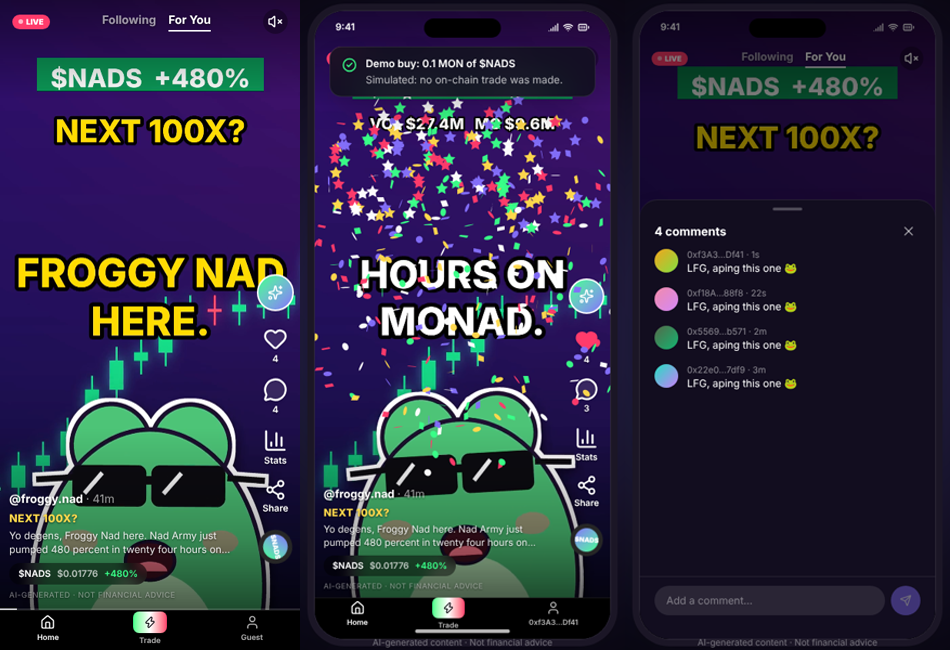

# AlphaScroll

**Scroll a memecoin, double-tap, own it.** A TikTok-style feed for Monad where every reel is about a live token, an AI pipeline makes the reels on its own, and a double-tap is a real on-chain buy.



| | |
|---|---|
| Live app | <!-- TODO: add the Vercel URL --> `https://…vercel.app` |
| 2-minute demo video | <!-- TODO: add the link --> |
| Network | Monad testnet (chain id `10143`) |
| Vault contract | [`0x222b7A69766a163c1C2c315934F48E06a3D1C268`](https://testnet.monadexplorer.com/address/0x222b7A69766a163c1C2c315934F48E06a3D1C268) |
| Tests | 11 contract tests + 5 web tests, all passing |

---

## The problem

Memecoin traders find tokens on X, Telegram and Farcaster, then switch to a DEX, paste a contract address, approve, swap and confirm. By the time they've done that, the moment has passed. The discovery happens in a social feed; the trade happens somewhere else.

**Who it's for:** people who already trade small amounts of memecoins on their phone and spend their day scrolling short video.

**What AlphaScroll does:** it puts discovery and execution in the same gesture. The feed shows one token per reel, with live price, volume and on-chain buyer activity. Double-tap means "like and buy". The tokens land in your own wallet.

**Why it lasts past today:** the feed fills itself. A worker picks tokens with real on-chain activity (fresh trades, AlphaScroll buys, Farcaster buzz), writes a script, voices it and renders a vertical video, every few minutes, with free tools only. Creators can also upload their own reels. There's no content team to run out of.

## How it works

```
 DexScreener · GeckoTerminal trades · Farcaster · AlphaScroll buys
                         │
                         ▼
 ┌──────────────── worker/ (Python) ────────────────┐
 │ pick token → LLM script → voice + word timings   │
 │ → AI background → avatar → 1080x1920 MP4         │
 └──────────────────────┬───────────────────────────┘
                        │ videos + SQLite/Turso row
                        ▼
 ┌──────────────── web/ (Next.js 16) ───────────────┐
 │ snap-scroll feed · likes · comments · follows    │
 │ share-to-user inbox · creator uploads · stats    │
 │ double-tap ─────────────────────────┐            │
 └─────────────────────────────────────┼────────────┘
                                       ▼
 ┌──────────────── Monad testnet ───────────────────┐
 │ AlphaScrollSessionVault → V2 router → token      │
 │ Bought event ─► /api/trades verifies receipt     │
 └──────────────────────────────────────────────────┘
                        │
                        └─► trades feed back into which token gets the next reel
```

The loop is the point: what people buy on AlphaScroll decides what the worker films next, so the feed follows real demand instead of a schedule.

## Why it needs Monad

The chain isn't a payment rail bolted on at the end. Three parts of the product only work because they're on-chain, and two only work because it's Monad.

1. **The vault enforces the spending rules, not our server.** `AlphaScrollSessionVault` holds the user's MON and lets a browser-generated session key do exactly one thing: `buy(token, amountIn, minOut, deadline)`. Expiry, per-trade cap and total budget are checked in the contract. Bought tokens go straight to the owner's address. A leaked key can't withdraw a single wei. No backend could give the same guarantee.
2. **Trades are verified from chain state.** `/api/trades` doesn't trust the client. It fetches the receipt from the RPC and accepts the trade only if it contains a `Bought` event from our vault for the signed-in wallet. Amounts come from the log. Trade counts and the "live buyers" ranking can't be faked.
3. **Self-custody.** The user keeps their tokens in their own wallet. AlphaScroll never holds them.
4. **Monad: sub-second blocks** make "double-tap → confetti → tokens in wallet" feel like a like button, not a trade ticket. On a 12-second chain, the gesture doesn't work.
5. **Monad: cheap gas** makes 0.05 MON impulse buys reasonable. Gas is about 0.015 MON per buy at 100 gwei, small enough to pre-fund a session key once (0.1 MON stipend) and forget about it.

We also built around Monad specifics rather than ignoring them: Monad bills the full gas limit, so the stipend and sweep math use the limit; and Monad checks balances against a slightly delayed state ([reserve balance](https://docs.monad.xyz/developer-essentials/reserve-balance)), so a freshly funded session key waits 3 blocks before its first buy (`web/src/lib/web3/trading.ts`).

## What's real and what isn't

| Part | Status |
|---|---|
| Session vault on Monad testnet (deposit, session keys, caps, `buy`, revoke, withdraw) | **Live**, deployed and covered by 11 tests |
| Test DEX on Monad testnet (WMON, V2-style router, 6 memecoins with liquidity) | **Live**. Real swaps, but testnet pools we seeded (see below) |
| Double-tap buy of a testnet token | **Live**: one wallet confirmation sets up a session, then every double-tap is a real swap through the vault with no popup, and an explorer link in the toast |
| Server-side trade verification from the `Bought` event | **Live** |
| AI video worker (token pick → script → voice → image → avatar → MP4) | **Live**: renders a reel in about a minute, on a loop |
| Feed, likes, comments, follows, share-to-user inbox, notifications, saved reels | **Live**, stored in SQLite locally or Turso in production |
| Creator MP4 uploads (Vercel Blob / R2 / local disk) | **Live** |
| Live token stats (DexScreener, GeckoTerminal trades) | **Live** for mainnet tokens; testnet tokens show their render-time snapshot |
| Reels about mainnet tokens (`--source dexscreener`) | Market data is real; buying them is **disabled** while the app runs on testnet |
| Mock tokens (when no deployment file exists) | **Demo mode**: confetti and a trade recorded as `demo`, no transaction |

## What's original

- **Discovery and execution in one gesture.** Most "SocialFi" apps put a buy button next to content. Here the content's native gesture, the double-tap, is the trade.
- **A feed nobody has to feed.** The reels are made by an autonomous pipeline that only uses free tools (Groq, OpenRouter free models, Edge-TTS, Pollinations, MoviePy), with a fallback at every step so it never stops.
- **On-chain demand steers content.** The worker ranks candidates by recent swaps, AlphaScroll buys and Farcaster cashtag mentions, so the next reel is about what people are actually buying.
- **VTuber-style mascots drawn in code.** The `avatar` format animates Monad-community mascots (Froggy Nad, Chog Cat, Nad Blob) with Pillow: lip-sync from voice loudness, blinking, bounce on loud syllables. No GPU or model download.
- **Bounded session keys instead of "trust us" custody.** One wallet confirmation gives the browser a key that can only buy, only up to a budget, only until expiry.

## Demo walkthrough (2 minutes)

1. Open the app on a phone (or desktop, which shows an iPhone frame). Scroll: each reel is about a different Monad token, narrated by an AI mascot with word-synced captions.
2. Tap the stats icon: price, volume and the last minutes of on-chain trades.
3. Click **Connect MetaMask**. The app adds Monad testnet and switches to it.
4. Double-tap a reel about a testnet token (e.g. `$CHOG`). The first time, **One-tap trading** opens: pick a budget, an amount per tap and an expiry, and confirm once in MetaMask. The buy then goes through: confetti, and a toast with the explorer link. The tokens are in your wallet.
5. Scroll and double-tap a few more reels. No more wallet popups: each tap is signed by the session key and settles in about a second.
6. Open the Trade tab to see the vault balance and what's left of the session budget, and revoke the session to get the remaining MON back.
7. Show the worker terminal: a new reel is being rendered about the token you just bought, and it appears as a "1 new reel" pill in the feed.

## Deployed contracts (Monad testnet, `10143`)

| Contract | Address |
|---|---|
| `AlphaScrollSessionVault` | [`0x222b7A69766a163c1C2c315934F48E06a3D1C268`](https://testnet.monadexplorer.com/address/0x222b7A69766a163c1C2c315934F48E06a3D1C268) |
| `AlphaTestRouter` (V2-compatible) | [`0x10e3cEa0162bc69F646aCC6284a02512059E1F8F`](https://testnet.monadexplorer.com/address/0x10e3cEa0162bc69F646aCC6284a02512059E1F8F) |
| `WMON` | [`0x4dD6528f745cFe5C0fc8A5939b674d75b1Ff529C`](https://testnet.monadexplorer.com/address/0x4dD6528f745cFe5C0fc8A5939b674d75b1Ff529C) |
| Test tokens | `MOLANDAK`, `CHOG`, `MOYAKI`, `PURPLE`, `GMONAD`, `NADS`: see [contracts/deployments/10143.json](contracts/deployments/10143.json) |

## Run it locally

Requires Python 3.10+ and Node.js 22.5+ (the app uses the built-in `node:sqlite`). No GPU, no paid API.

```bash
# 1. Render a first reel (works offline thanks to the fallbacks)
cd worker
pip install -r requirements.txt
cp .env.example .env          # optional: free GROQ_API_KEY / OPENROUTER_API_KEY
python video_worker.py
cd ..

# 2. Start the app
cd web
npm install
cp .env.example .env.local    # set AUTH_SECRET (npx auth secret) and NEXT_PUBLIC_VAULT_ADDRESS
npm run dev                   # http://localhost:3000
```

To use the contracts that are already deployed, set `NEXT_PUBLIC_VAULT_ADDRESS=0x222b7A69766a163c1C2c315934F48E06a3D1C268` in `web/.env.local`, and get test MON from the [Monad faucet](https://faucet.monad.xyz).

### Deploy your own contracts

```bash
cd contracts && npm install
DEPLOYER_PRIVATE_KEY=0x... npm run setup:testnet
# PowerShell: $env:DEPLOYER_PRIVATE_KEY="0x..."; npm run setup:testnet
```

This deploys the test DEX, six memecoins with liquidity and the vault, writes `contracts/deployments/10143.json` (and a copy in `web/src/lib/web3/deployment.json`, where the app reads the router and token addresses) and sets `NEXT_PUBLIC_CHAIN_ID` and `NEXT_PUBLIC_VAULT_ADDRESS` in `web/.env.local`. It's resumable: if it stops halfway, run it again. Use a fresh account with about 2 MON. After that, new reels from the worker are tagged with the real token addresses.

`setup:testnet` accepts `LIQUIDITY_MON` (MON per pool, default 0.2) and `RPC_URL`. To deploy only the vault against an existing V2 router: `DEPLOYER_PRIVATE_KEY=0x... ROUTER_ADDRESS=0x... npm run deploy`. After changing the contract, `npm run abi` regenerates `web/src/lib/web3/vaultAbi.ts`.

### Tests

```bash
cd contracts && npm test        # 11 tests on Ganache, incl. a full setup:testnet run
cd web && npm test              # 5 tests: live-feed ranking, uploads
```

## Under the hood

### Contracts (`contracts/`)

`AlphaScrollSessionVault.sol`:

- `authorizeSession(key, expiry, maxPerTrade, budget, gasStipend)`: one payable call deposits MON, forwards a gas stipend to the session key and authorises it. It replaces any previous session.
- `buy(token, amountIn, minOut, deadline)`: callable by the session key (within its caps) or by the owner. Swaps on a Uniswap V2-compatible router with `swapExactETHForTokensSupportingFeeOnTransferTokens` and sends the tokens to the owner. `amountOut` is measured as the owner's balance change, so fee-on-transfer tokens work.
- `revokeSession()`, `withdraw(amount)`: owner only. All state-changing functions are `nonReentrant` and update state before external calls.

`testnet/AlphaTestDex.sol` (testnet only): `TestToken`, `WMON` and `AlphaTestRouter`, a constant-product router with a 0.3% fee.

### Video worker (`worker/`)

| Step | Tool | Fallback |
|---|---|---|
| Token pick | Monad testnet tokens, or DexScreener + GeckoTerminal trades + Farcaster (Neynar) + AlphaScroll buys | Mock token |
| Script + image prompt | Local Ollama (optional), Groq `openai/gpt-oss-120b`, OpenRouter free models | Template script |
| Voice + word timings | Fish Audio S2 + Groq Whisper, or Edge-TTS | Silent track with estimated timings |
| Background | Pollinations.ai, SDXL-Lightning on a local GPU (optional) | Procedural neon chart |
| Render | MoviePy 2 + FFmpeg, frames rendered in parallel: Ken Burns zoom, ticker badge, word-synced captions, avatar | — |
| Publish | SQLite locally; Turso + Vercel Blob or R2 in production | — |

```bash
python video_worker.py                        # one reel
python video_worker.py --source dexscreener   # live Monad mainnet token, picked by activity
python video_worker.py --format avatar --persona chog
python video_worker.py --loop                 # daemon
```

Personas: `froggy` (Froggy Nad), `chog` (Chog Cat), `blob` (Nad Blob). Add one with a `Persona(...)` entry in `avatar.py`. All settings are documented in [worker/.env.example](worker/.env.example).

### Web app (`web/`)

Next.js 16 (App Router), React 19, Tailwind CSS v4, Framer Motion, wagmi/viem, NextAuth v5, libSQL.

- **Feed:** CSS snap scroll; only the visible video plays and the next one is preloaded. New reels appear as a "N new reels" pill instead of moving the video you're watching.
- **Gestures:** tap to pause, double-tap to like and buy. Arrow keys scroll, `m` toggles sound.
- **Social:** comments, follows, follower lists, share a reel to another user, inbox with notifications, saved reels, creator uploads (MP4 up to 50 MB, signature-checked).
- **Login:** MetaMask or any injected wallet, with Sign-In with Ethereum (single-use nonce in an httpOnly cookie, domain/chain/expiry checks, EOA and ERC-1271/6492 signatures). Guests can browse.

| Route | |
|---|---|
| `GET /api/feed?cursor=&limit=` | Paginated reels with like/comment/trade counts |
| `POST /api/trades` | Record a buy; on-chain buys are verified from the receipt |
| `GET /api/videos/:id/stats` | Live token stats, cached 15 s |
| `POST /api/videos/:id/like`, `GET/POST /api/videos/:id/comments`, `POST /api/videos/:id/share` | Social actions |
| `GET/POST /api/uploads` | Creator uploads |
| `GET /api/users`, `POST /api/users/follow`, `GET /api/users/stats`, `GET /api/inbox`, `GET/POST /api/saved` | Profiles, follows, notifications, saved reels |
| `GET /api/auth/nonce`, `/api/auth/*` | SIWE nonce and NextAuth |

Production runs on Vercel (Root Directory `web/`) with Turso for data and Vercel Blob or Cloudflare R2 for media. See [web/.env.example](web/.env.example).

## Security

The contracts have tests and an internal review, manual plus Slither, in [contracts/SECURITY.md](contracts/SECURITY.md). **There has been no professional audit.** No critical or high findings; the main accepted risk is that a leaked session key can make bad trades within its remaining budget. It can never withdraw.

## What's unfinished

We'd rather tell you than have you find it:

- **Testnet only.** Tokens and pools are ones we deployed, so prices are not market prices. Mainnet needs a real DEX router and an audit.
- **Session keys live in `localStorage`.** An XSS bug would expose one; the damage is capped by the session budget (W-1 in SECURITY.md).
- **No sell button.** You buy from the feed and sell in your own wallet or DEX.
- **No content moderation** for creator uploads beyond the file checks.
- **AI scripts can be wrong.** They're generated from market data and labelled as such, not financial advice.

## Roadmap

1. Per-session token allowlist in the vault, and a signature from the session key in `authorizeSession` (fixes V-1's second attack and V-2).
2. Mainnet: integrate an existing Monad V2 router, professional audit.
3. Creator revenue share: a cut of the swap fee on buys made from a creator's reel, paid on-chain.
4. Sell from the feed and a portfolio view with P&L.
